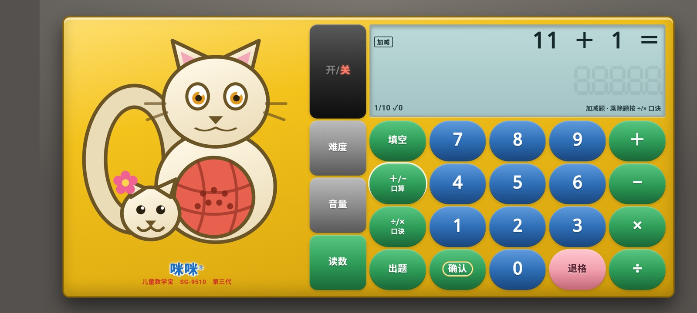
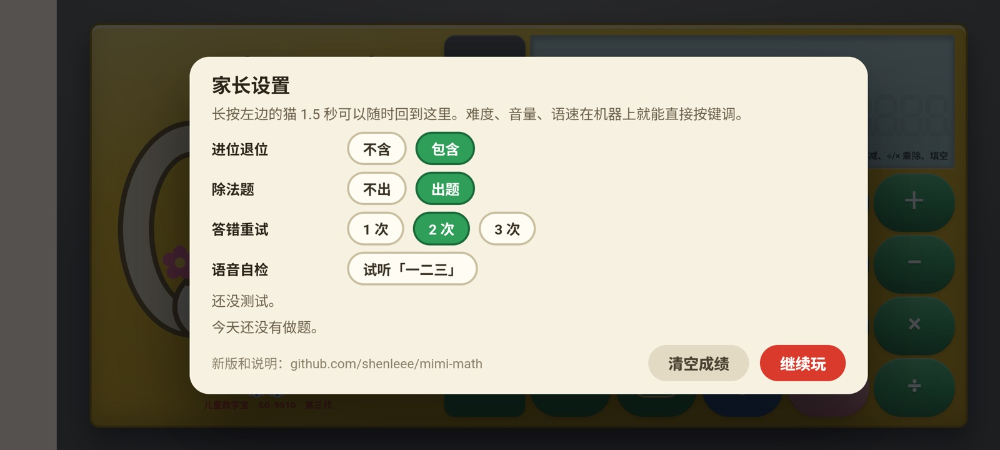

# 咪咪数学宝 · 儿童数学学习机

一台模拟 90 年代儿童数学学习机的小 App：开机报题、按键作答、答对夸一句，还会背九九乘法口诀。适合刚开始学加减乘除的小朋友。

- **完全离线**：不联网，不申请任何权限，不收集任何信息。
- **成绩自动保存**在手机里，关掉再开还在。
- **休息提醒**：每玩 15 分钟提醒休息一次。

## 下载

👉 **[下载最新版 APK](https://github.com/shenleee/mimi-math/releases/latest)**（Android 5.0 及以上的手机和平板）

在国内打开 GitHub 有时会比较慢，下载不动可以多试几次，或者换个时间再试。

## 安装

1. 用手机浏览器打开上面的链接，在 **Assets** 里点 `mimi-math-x.x.apk` 下载。
2. 下载完点开这个文件。手机会提示「禁止安装未知来源的应用」之类的话，按提示进设置，允许浏览器（或文件管理）安装应用。
3. 回到安装界面点「安装」。有的手机会先做安全扫描，或者要求登录手机厂商的账号，按提示继续就行。
4. 装好后，桌面上会出现「咪咪数学宝」的小猫图标。

### 安装常见问题

| 情况 | 怎么办 |
|---|---|
| 提示「风险应用」「未经检测」 | 因为没上架应用商店，手机会例行提醒。这个 App 不申请任何权限、不联网，可以继续安装。 |
| 微信里收到的安装包点不开 | 微信会把 `.apk` 文件改名成 `.apk.1`。选「用其他应用打开」→「文件管理」，把文件名最后的 `.1` 删掉再点开。直接用浏览器下载最省事。 |
| 华为手机装不上 | 鸿蒙 4 及以前：到「设置 → 系统和更新 → 纯净模式」里关掉纯净模式再装。**鸿蒙 5 及以后不支持安装 APK**，暂时没法用。 |
| 怎么更新 | 下载新版直接安装，会覆盖旧版，成绩和设置都保留。 |
| 卸载 | 卸载会清空成绩和家长设置。 |

## 怎么玩

机器是横屏的。小猫右边那一竖排是功能键（开/关、难度、音量、读数），再往右是题型键、数字键和运算键。

**开机**：按「开/关」，听到「咪咪数学学习机开始学习吧」就可以开始了。

**选题型**

| 按键 | 做什么 |
|---|---|
| ＋/− 口算 | 加减法口算 |
| 填空 | 填空题，比如 `5 + ? ＝ 8` |
| ÷/× 口诀 | 背乘法口诀，再按一次换成除法口诀；按 2–9 只听那一列；按「出题」做乘除题 |
| ＋ − × ÷ | 单项专练：按哪个符号，就只出哪一种题 |

**做题**

1. 按「出题」，机器会把题目念出来。
2. 用数字键输入答案，按「确认」交卷。
3. 输错了按「退格」删一位，长按任意数字键可以全部清空。
4. 答错了可以再试；再错，机器会说出正确答案。做错的题过一会儿还会再出现。
5. 每轮 10 道题，每题 10 分，做完会报成绩。

**其他按键**

- **难度**：在 10 以内、20 以内、100 以内之间切换。
- **音量**：在大、中、小、静音之间切换，也可以直接按手机的音量键。
- **读数**：输入一个数（最多 5 位），按「确认」，机器会把它读出来。

**家长设置**：长按左边的小猫 1.5 秒打开。可以设置题目包不包含进位退位、出不出除法题、答错能重试几次，还能试听语音、查看和清空成绩。

**退出**：连按两次返回键。成绩和设置都会自动保存。

## 隐私

- 不联网，安装时也不会请求任何权限。
- 不收集、不上传任何信息。成绩只存在这台手机上。

## 授权

本 App 免费使用。

语音用 [Kokoro-82M-v1.1-zh](https://huggingface.co/hexgrad/Kokoro-82M-v1.1-zh)（Apache-2.0，中文语音数据由 LongMaoData 提供）离线合成。
